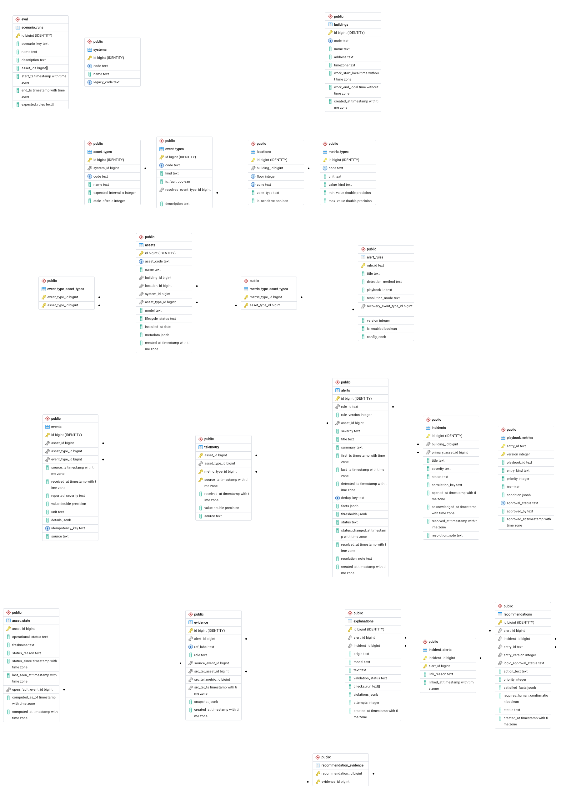

# Data Model: Anzma AI Insight

PostgreSQL 16 unified schema, defined in `migrations/001_unified_schema.sql`.
It replaces the legacy `schema.sql` and `schema_day4.sql`.

## Entity-relationship diagram

The diagram shows 22 tables: 21 in the `public` schema and `eval.scenario_runs`.
The schema also defines two convenience views, `v_assets` and `v_events`, which are not drawn.

## Table groups

| Group | Tables | Purpose |
|---|---|---|
| Building structure | `buildings`, `locations` | Where things are. `buildings` holds the IANA timezone and working hours; `locations` holds `zone_type` and `is_sensitive`. |
| Catalogues | `systems`, `asset_types`, `metric_types`, `event_types` | What can exist. Adding a new building system or type is an `INSERT`, not a code change. |
| Compatibility | `metric_type_asset_types`, `event_type_asset_types` | What may be recorded on which asset type. |
| Assets | `assets` | Physical devices. |
| Facts (append-only) | `telemetry`, `events` | Measured samples and discrete occurrences. Never updated or deleted. |
| Current condition | `asset_state` | Derived status and freshness per asset. |
| Detection logic | `alert_rules`, `playbook_entries` | Approved engineering logic, versioned. |
| Alerting | `alerts`, `incidents`, `incident_alerts` | Alerts and incidents have separate lifecycles. |
| Traceability | `evidence`, `recommendations`, `recommendation_evidence`, `explanations` | What supports each alert, action and AI explanation. |
| Test harness | `eval.scenario_runs` | Ground truth for evaluation. The engine must never read the `eval` schema. |

## Design rules

1. **Facts are append-only.** `telemetry` and `events` reject `UPDATE` and `DELETE` through triggers.
2. **Current condition is separate from history.** It lives in `asset_state`.
3. **Silence is never healthy.** `asset_state` cannot be `NORMAL` unless the asset is `FRESH` or `NOT_APPLICABLE`.
4. **Evidence keeps hard foreign keys** to its source row (an event, or a telemetry sample), plus a verbatim snapshot.
5. **Nothing cascades.** Every foreign key is `ON DELETE RESTRICT`.
6. **Configuration is data.** Thresholds live in `alert_rules.config`, playbooks in `playbook_entries`, working hours in `buildings`.
7. **AI output is labelled.** `explanations.validation_status` records what was actually checked; `VALIDATED` requires a semantic check.

## Key relationships

| Relationship | Notes |
|---|---|
| `locations` -> `buildings` | One building has many locations. |
| `assets` -> `locations` | Composite key `(location_id, building_id)`: an asset's building must match its location's building. |
| `assets` -> `asset_types` | Composite key `(asset_type_id, system_id)`: an asset's system must match its type's system. |
| `telemetry` -> `assets`, `metric_types` | Composite keys also check that the metric is allowed for the asset type (`metric_type_asset_types`). |
| `events` -> `assets`, `event_types` | Same pattern, checked against `event_type_asset_types`. |
| `event_types.resolves_event_type_id` | A `RECOVERY` event points to the event it closes (for example `LINK_UP` closes `LINK_DOWN`). |
| `alerts` -> `alert_rules`, `assets` | One alert per rule and asset occurrence; `dedup_key` is unique. |
| `incident_alerts` | An alert belongs to at most one incident (`alert_id` is unique). |
| `evidence` -> `events` or `telemetry` | Exactly one source kind per row (database check). |
| `recommendations` -> `playbook_entries` | Key `(entry_id, version, approval_status)`. |
| `explanations` -> `alerts` or `incidents` | At least one must be set. |

## Regenerating the diagram

In pgAdmin: right-click the database, choose **ERD For Database**, arrange the tables, check that
the relationship lines are visible, then export as PNG to `docs/ERD-unified.png`.
