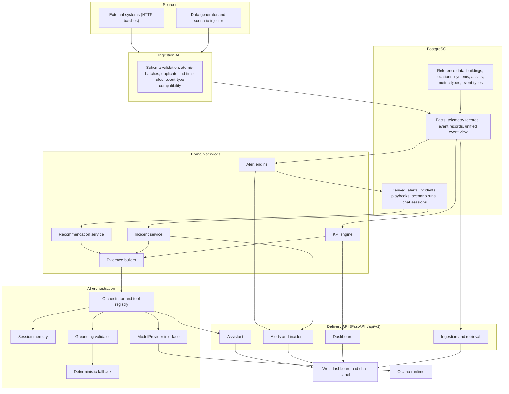
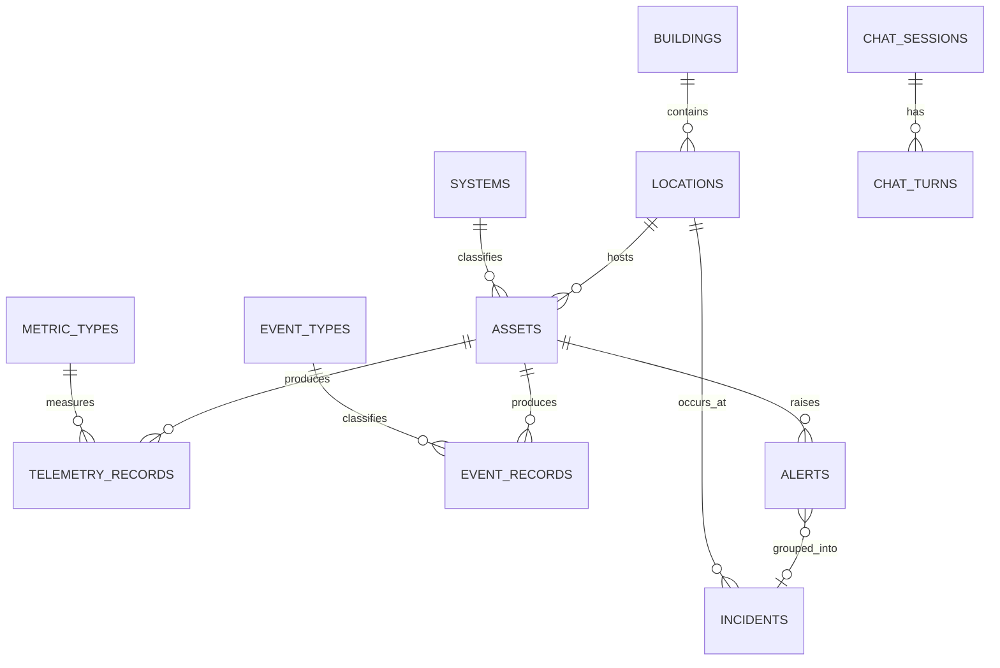
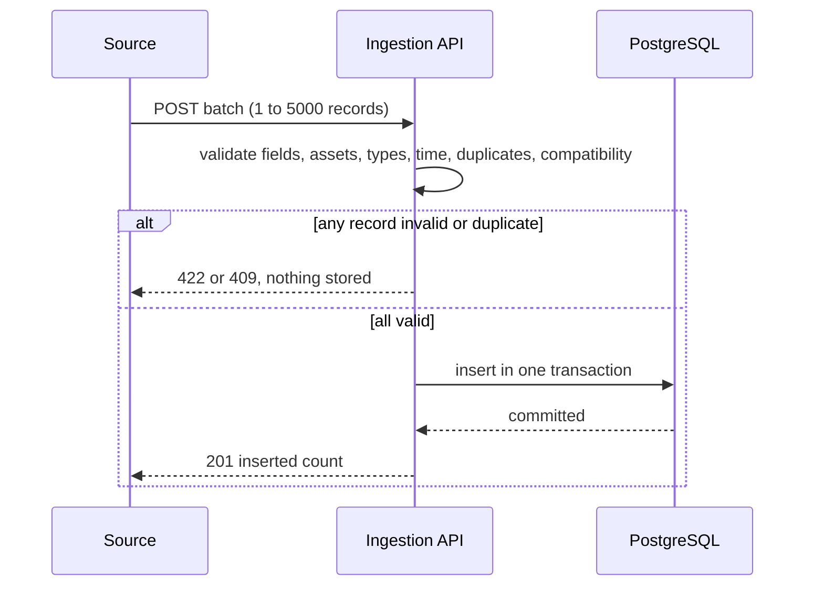
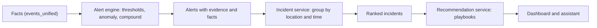
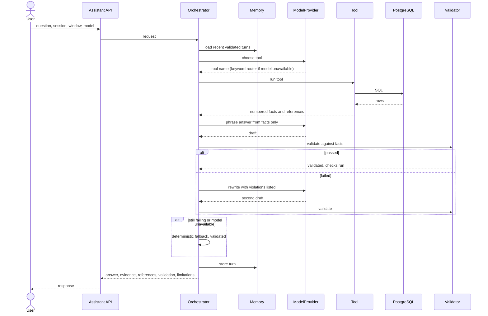

# Anzma Unified Platform - Architecture

Smart-building monitoring platform that ingests telemetry and events from HVAC, Network, Access Control, CCTV and Fire Alarm systems, detects faults, groups them into incidents, and explains them through a dashboard and a grounded, bilingual AI assistant.

| | |
|---|---|
| **Document** | ARCHITECTURE.md |
| **Scope** | Unified architecture, major components, interfaces and data flow |
| **Related** | DECISION_MATRIX.md, DATA_MODEL.md, API_CONTRACT.md, INTEGRATION_PLAN.md |

---

## 1. Purpose

The platform answers three operational questions for a building team:

1. **What is happening?** Live status, KPIs and trends per system.
2. **What is wrong?** Alerts and incidents with the evidence that triggered them.
3. **What should we do?** Ranked corrective actions, explained in natural language (Arabic or English) and traceable to real measurements.

The platform is the integration of two prior implementations into one codebase, one database and one set of interfaces.

## 2. Architectural principles

| # | Principle | Consequence |
|---|---|---|
| 1 | **One database, one data-access layer** | All modules read and write PostgreSQL through shared repositories. No module opens its own connection. |
| 2 | **The model never touches data** | The language model selects a tool and phrases text. Facts always come from SQL executed by code. |
| 3 | **Every answer carries evidence** | Alerts, incidents and assistant answers reference the events, readings and assets they are built from. |
| 4 | **Validated means verified** | An answer is marked validated only when validation checks ran and passed. |
| 5 | **Graceful degradation** | If the model is unavailable or fails validation, a deterministic answer built from the same facts is returned. |
| 6 | **Local-first AI** | Ollama is the model runtime. No cloud dependency in the default build. |
| 7 | **Layered and replaceable** | Each layer depends only on the layer below it. Model providers, rules and playbooks can be swapped without touching the API. |

## 3. System overview



### Layers

| Layer | Responsibility |
|---|---|
| **Sources** | Produce telemetry and events: the simulator and scenario injector, and any external client posting batches. |
| **Ingestion API** | Validate and store incoming data atomically. |
| **Data layer** | PostgreSQL holds reference data, facts and derived objects. |
| **Domain services** | KPI calculation, alert detection, incident grouping, recommendations and evidence assembly. |
| **AI orchestration** | Tool selection, fact retrieval, answer generation, validation, fallback and session memory. |
| **Delivery API** | Versioned REST interface (`/api/v1`) consumed by the dashboard and external clients. |
| **Clients** | Dashboard and chat panel. |

## 4. Components

### 4.1 Ingestion

- Endpoints for telemetry and event batches (1 to 5000 records per request).
- A batch is atomic: all records are stored or none are.
- Validation covers field formats, known assets, metric and event types, future timestamps, duplicates, and an **event-type compatibility table** that prevents an event type from being recorded against an asset of the wrong system.
- Accepted records are immediately visible to the alert engine through the unified event view.

### 4.2 Data layer (PostgreSQL)

Three groups of tables:

| Group | Tables |
|---|---|
| Reference | `buildings`, `locations`, `systems`, `assets`, `metric_types`, `event_types`, `event_type_compatibility` |
| Facts | `telemetry_records`, `event_records`, and the view `events_unified`, which presents telemetry and events as one chronological stream |
| Derived | `alerts`, `incidents`, `incident_alerts`, `playbooks`, `scenario_runs`, `chat_sessions`, `chat_turns` |



Conventions: timestamps are `TIMESTAMPTZ` stored in UTC; severity is `INFO`, `WARNING` or `CRITICAL`; system codes are `HVAC`, `NETWORK`, `ACCESS`, `CCTV`, `FIRE_ALARM`.

### 4.3 KPI engine

Computes the eight operational KPIs from the fact tables at request time, for a selectable window, system and location. Each KPI has a single definition used by the dashboard, the alert layer and the assistant:

total events, critical alerts, network availability, average bandwidth, access denial rate, average HVAC temperature, camera offline incidents, active fire alarms.

Network availability nets recovered outages against open ones, and active fire alarms reflect the latest smoke/reset state per panel.

### 4.4 Alert engine

- A catalogue of 16 rules across the five systems, using three detection methods: **threshold**, **statistical anomaly** (robust z-score over a rolling baseline) and **compound** (several conditions across systems).
- Each alert stores its severity, detection method, time span, the evidence events that triggered it and the measured facts behind the decision.
- Alerts follow a lifecycle: `OPEN`, `ACKNOWLEDGED`, `RESOLVED`.
- Thresholds and rules are configuration, not code.

### 4.5 Incident service

Groups related alerts into a single incident so one underlying fault is presented once.

- **Grouping rule:** alerts in the same location whose time spans fall within 15 minutes of each other. The compound rule (camera offline with door activity) is the first cross-system case.
- **Ranking:** incidents are ordered by severity, number of affected assets and duration.
- Incidents have stable identifiers and reference their alerts, assets and location.

### 4.6 Recommendation service

- Playbooks map each rule to candidate **causes** and **actions**, each with a condition on the measured facts. A cause or action is offered only when the facts satisfy its condition.
- Playbooks are versioned data with an approval status.
- Recommendations are advisory. The platform never controls equipment.

### 4.7 Evidence builder

Turns alerts, incidents, KPIs and readings into **numbered facts** (`F1`, `F2`, ...), each with human-readable text and structured data. These facts are the only input the assistant is allowed to use.

### 4.8 AI orchestration

| Part | Role |
|---|---|
| **Tool registry** | Six read-only tools: building status, recent faults, CCTV availability, network issues, corrective priorities, energy consumption change. Each tool runs SQL collectors and returns facts plus references. |
| **Orchestrator** | Chooses a tool, runs it, asks the model to phrase the answer, validates it, retries once, and falls back if needed. |
| **ModelProvider** | Interface for text generation. `OllamaProvider` is the implementation (Qwen 2.5 and Llama 3.2). |
| **Keyword router** | Deterministic intent classifier used when the model is unavailable. |
| **Grounding validator** | Checks that every citation exists, every number, time and date appears in the cited facts, asset names are exact, required facts are cited, and unsupported judgments are absent. |
| **Deterministic fallback** | Builds the answer directly from the facts and validates it the same way. |
| **Session memory** | Stores the last turns of a session: question, tool, answer id and validation status. Only validated answers feed later turns. |

### 4.9 Delivery API

FastAPI application with versioned routers and Pydantic schemas. Routers: ingestion, retrieval, dashboard, alerts, incidents, assistant. Interactive documentation is served at `/docs`. See `API_CONTRACT.md`.

### 4.10 Dashboard

Single-page web interface served by the application:

- System status indicators (OK, Warning, Critical, No data) with click-to-filter.
- KPI cards with definitions, trend charts, equipment health table.
- Incident and alert lists with evidence.
- Chat panel connected to the assistant, with model selection and visible validation status.
- Filters: system, location, time window.

## 5. Data flows

### 5.1 Ingestion



### 5.2 Detection to incident



### 5.3 Assistant question to answer



## 6. Technology stack

| Concern | Choice |
|---|---|
| Language | Python 3.11 |
| API | FastAPI, Pydantic v2, Uvicorn |
| Database | PostgreSQL (JSONB for system-specific attributes, `TIMESTAMPTZ`) |
| DB access | psycopg2 with a connection pool |
| Local AI | Ollama with Qwen 2.5 and Llama 3.2 |
| Dashboard | HTML, JavaScript, SVG charts, served by FastAPI |
| Testing | pytest |
| Environment | `.env` configuration, Docker Compose for PostgreSQL |

## 7. Cross-cutting conventions

| Topic | Convention |
|---|---|
| Time | UTC everywhere in storage and API (ISO 8601 with `Z`). Local time is used only for display and after-hours rules. |
| Time windows | Selectable windows (1, 6, 12, 24 hours) anchored to the latest event in the dataset. |
| Identifiers | Integer ids for entities; unique asset names (for example `HVAC-AHU-01`). |
| Errors | One envelope: `{error: {code, message, details}}`. "No matching records" and "data unavailable" are distinct codes. |
| Languages | Arabic and English for questions and answers. Technical identifiers (asset names, event types) are never translated. |
| Configuration | Thresholds, rules, playbooks and model settings are configuration, not hard-coded logic. |
| Security | Input validation on every endpoint, parameterized SQL, read-only assistant tools. Authentication is a planned later layer. |

## 8. Scenarios

Six fault scenarios are injected into the dataset, with ground truth stored separately in `scenario_runs` so the detection layer cannot see it:

| ID | Scenario |
|---|---|
| S1 | Server-room cooling failure |
| S2 | Core switch saturation and link flapping |
| S3 | Night-time badge brute force |
| S4 | Camera blind spot with after-hours door activity |
| S5 | Fire panel on battery with smoke alarm |
| S6 | Clogged filter and temperature drift |

Scenarios drive demonstrations, regression tests and measurement of detection quality (detection rate, latency, evidence integrity).

## 9. Quality attributes

| Attribute | How the architecture provides it |
|---|---|
| **Traceability** | Alerts store evidence; assistant answers cite numbered facts; incidents reference their alerts. |
| **Reliability** | Atomic ingestion, deterministic fallback, validated answers only. |
| **Extensibility** | New rules, playbooks, tools and model providers are added through registries and configuration. |
| **Testability** | Layers are independent; scenarios provide repeatable inputs with known expected outcomes. |
| **Performance** | Indexed queries on `(asset, time)`, request-time aggregation over bounded windows, single DB pool. |
| **Portability** | Runs locally with Docker for the database and Ollama for the model. |

## 10. Repository layout

```
app/
  main.py  config.py  db.py
  api/v1/        ingestion.py  retrieval.py  dashboard.py  alerts.py  incidents.py  assistant.py
  schemas/
  services/      kpi/  alerting/  incidents/  recommendations/  evidence/
  assistant/     orchestrator.py  memory.py  validator.py  fallback.py  tools/  providers/
  static/
db/              schema.sql  views.sql  seed_reference.sql
scenarios/       generate_data.py  inject_scenarios.py
tests/
docker-compose.yml  .env.example  requirements.txt  README.md
```
